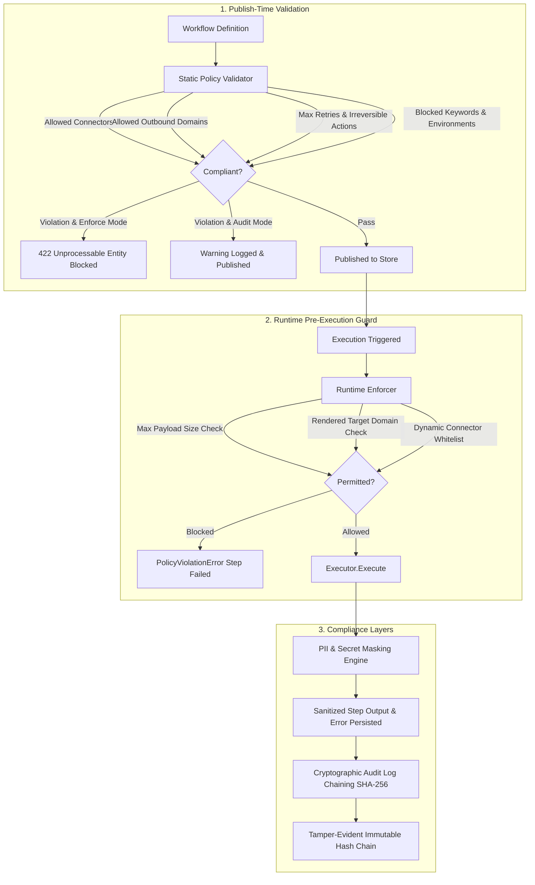

# Enterprise Governance, Policy Engine & Tamper-Evident Audit Chains

Kerob provides enterprise-grade governance controls designed for SOC2, ISO27001, and HIPAA compliance environments. It ensures that workflow authoring and execution adhere strictly to organizational security standards, enforces tenant isolation, guarantees immutable audit logging with cryptographic hash chaining, and automatically masks Personally Identifiable Information (PII) and secret credentials.

---

## 1. Architectural Overview

Governance in Kerob operates across two distinct enforcement phases and two security layers:



---

## 2. Policy Specification & Configuration

Tenant governance policies are managed per tenant and stored either in PostgreSQL (`governance_policies` table) or in-memory.

### Policy Fields

| Field | Type | Default | Description |
| :--- | :--- | :--- | :--- |
| `tenant_id` | `string` | *(inherited)* | Tenant organization identifier. |
| `allowed_connectors` | `[]string` | `[]` *(all)* | Whitelisted connector IDs (e.g. `["http", "telegram", "slack"]`). If non-empty, steps using any other connector are blocked. |
| `allowed_outbound_domains` | `[]string` | `[]` *(all non-SSRF)* | Whitelisted external domains (e.g. `["api.telegram.org", "*.github.com", "*.internal"]`). Exact and wildcard subdomains supported. |
| `max_workflow_retries` | `int` | `5` | Maximum retry count allowed on any workflow or step retry policy. |
| `max_payload_size_bytes` | `int64` | `1048576` (1MB) | Maximum payload size permitted for action execution payloads. |
| `data_retention_days` | `int` | `90` | Number of days before historical executions and audit logs become eligible for pruning. |
| `require_approval_irreversible` | `bool` | `false` | When `true`, any destructive or irreversible action (`delete`, `destroy`, `charge`, `refund`, etc.) must have an approval step. |
| `mask_pii` | `bool` | `true` | Automatically detect and redact email addresses, phone numbers, SSNs, and credit cards. |
| `mask_secrets` | `bool` | `true` | Automatically redact API keys, tokens, JWTs, and private keys. |
| `blocked_keywords` | `[]string` | `[]` | Blacklisted strings in workflow names, descriptions, or configs. |
| `allowed_environments` | `[]string` | `[]` | Allowed deployment environments (e.g. `["production", "staging"]`). |
| `enforcement_mode` | `string` | `"enforce"` | Either `"enforce"` (hard blocking with 422 HTTP status) or `"audit"` (record violations but allow operations). |

---

## 3. Cryptographic Audit Log Chaining

Kerob implements an immutable audit log trail backed by a SHA-256 cryptographic chain. Every recorded event is chained to its predecessor within the tenant partition:

```
[Genesis: 00000000...]
       |
  (Seq 1, PrevHash: Genesis, EntryHash: e1...)
       |
  (Seq 2, PrevHash: e1...,   EntryHash: e2...)
       |
  (Seq 3, PrevHash: e2...,   EntryHash: e3...)
```

### Entry Hash Formula
```
EntryHash = SHA256(TenantID | SequenceNum | PrevHash | ActorID | ActorType | Action | ResourceType | ResourceID | DetailsJSON | CreatedAtUnixNano)
```

### Verification & Tamper Detection
Administrators can verify the cryptographic integrity of the audit log chain at any time via the API, CLI, or Go/TypeScript SDKs:
```bash
kerob policy verify
```
```json
{
  "valid": true,
  "tenant_id": "tenant-alpha",
  "total_records": 1420,
  "verified_at": "2026-11-04T01:50:00Z"
}
```
If an unauthorized direct modification, entry deletion, sequence gap, or cross-tenant insertion occurs in the database, `VerifyAuditChain` immediately detects it and reports `broken_at_sequence` and the offending mismatch.

---

## 4. PII & Secret Detection and Masking

Kerob features a built-in masking engine that recursively traverses maps, slices, strings, and payloads before data is written to disk or returned in API previews.

### Redaction Rules

1. **Credit Cards**: Validated with the standard **Luhn algorithm** to prevent false positives on random 16-digit order numbers. Matches are replaced with `[REDACTED_CARD]`.
2. **Social Security Numbers (SSN)**: Standard US format `\b\d{3}-\d{2}-\d{4}\b` is replaced with `[REDACTED_SSN]`.
3. **Email Addresses**: Replaced with `[REDACTED_EMAIL]`.
4. **Phone Numbers**: International and US domestic formats are replaced with `[REDACTED_PHONE]`.
5. **Secrets & Credentials**:
   - Sensitive dictionary keys (`password`, `secret`, `token`, `api_key`, `access_key`, `private_key`, `auth`, `bearer`, etc.) are redacted to `[REDACTED]`.
   - Pattern scanning in strings:
     - AWS Access Keys: `\bAKIA[0-9A-Z]{16}\b` -> `[REDACTED_AWS_KEY]`
     - GitHub Tokens: `\bgh[pousr]_[A-Za-z0-9_]{36,255}\b` -> `[REDACTED_GITHUB_TOKEN]`
     - Slack Tokens: `\bxox[baprs]-[0-9A-Za-z-]{20,}\b` -> `[REDACTED_SLACK_TOKEN]`
     - JWT Tokens: `\beyJ[A-Za-z0-9_-]+\.eyJ[A-Za-z0-9_-]+\.[A-Za-z0-9_-]+\b` -> `[REDACTED_JWT]`
     - PEM Private Keys: `-----BEGIN [A-Z ]*PRIVATE KEY-----...` -> `[REDACTED_PRIVATE_KEY]`
     - Inline Authorization headers: `Bearer ...` -> `[REDACTED_AUTH]`

---

## 5. REST API Reference

### 1. Get Governance Policy
```http
GET /api/v1/governance/policy
Authorization: Bearer <token>
X-Tenant-ID: <tenant-id>
```
*Permission required: `policy:read`*

### 2. Update Governance Policy
```http
PUT /api/v1/governance/policy
Authorization: Bearer <token>
X-Tenant-ID: <tenant-id>
Content-Type: application/json

{
  "allowed_connectors": ["http", "telegram", "slack"],
  "allowed_outbound_domains": ["api.telegram.org", "*.stripe.com"],
  "max_workflow_retries": 3,
  "max_payload_size_bytes": 1048576,
  "data_retention_days": 90,
  "require_approval_irreversible": true,
  "mask_pii": true,
  "mask_secrets": true,
  "enforcement_mode": "enforce"
}
```
*Permission required: `policy:write` (Role: Owner, Admin)*

### 3. Dry-Run Policy Validation
```http
POST /api/v1/governance/policy/validate
Authorization: Bearer <token>
Content-Type: application/json

{
  "name": "Export Customer Records",
  "trigger": {"type": "webhook"},
  "actions": [
    {"id": "step1", "type": "action", "integration": "unapproved_service", "action_type": "export"}
  ]
}
```
Response (`422 Unprocessable Entity` or `200 OK` with violations summary):
```json
{
  "valid": false,
  "violations": [
    {
      "rule": "allowed_connectors",
      "field": "actions[0].integration",
      "message": "connector 'unapproved_service' is not in tenant allowed list",
      "details": {
        "integration": "unapproved_service",
        "allowed": ["http", "telegram", "slack"]
      }
    }
  ],
  "tenant_id": "tenant-alpha"
}
```

### 4. Verify Audit Chain
```http
GET /api/v1/governance/audit/verify
Authorization: Bearer <token>
```
*Permission required: `audit:read`*

### 5. Export Audit Logs
```http
GET /api/v1/audit-logs/export?format=csv&from=2026-11-01T00:00:00Z
Authorization: Bearer <token>
```
*Permission required: `audit:export`*

### 6. Retention Pruning
```http
POST /api/v1/governance/retention/prune
Authorization: Bearer <token>
```
*Permission required: `policy:write`*

---

## 6. CLI Usage

The Kerob CLI includes first-class governance commands:

```bash
# View active organization policy
kerob policy get

# In JSON format
kerob policy get --json

# Verify cryptographic audit trail integrity
kerob policy verify

# Export audit trail to CSV
kerob policy export csv > audit_trail_2026.csv

# Trigger retention cleanup
kerob policy prune
```

---

## 7. Cross-Tenant Isolation & Security Guarantees

1. **Tenant Bound**: Policies are strictly segregated by `tenant_id`. No caller can inspect or update another tenant's governance rules.
2. **Immutability**: Audit log records have monotonically increasing sequences and chained hashes. Any database-level tampering breaks the cryptographic verification.
3. **Fail-Closed Runtime**: In `enforce` mode, policy violations fail the step before any network calls or side-effects can occur.
